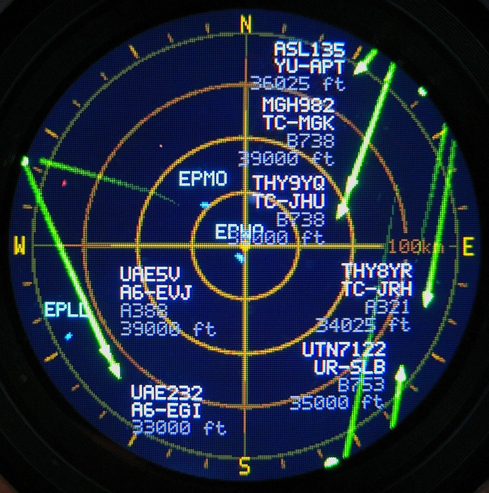
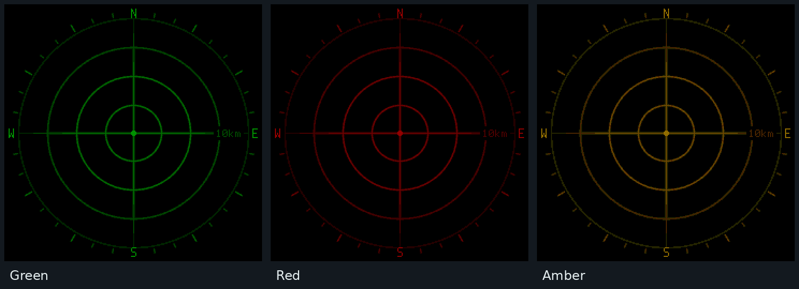
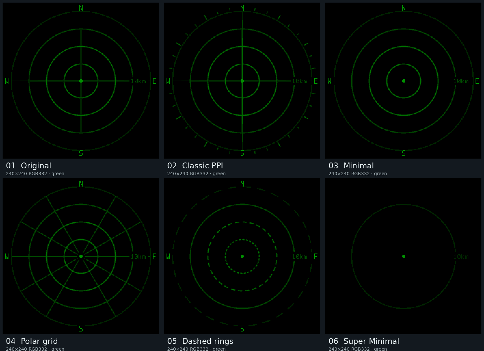

# Plane Radar — enhanced ESP32-C3 fork

A customized fork of [MatixYo/ESP32-Plane-Radar](https://github.com/MatixYo/ESP32-Plane-Radar), built for the **ESP32-2424S012 non-touch** board (ESP32-C3 + integrated 1.28-inch GC9A01, 240 × 240 round LCD).

**Fork release:** `v2.0.0`

This is an independently customized firmware branch, **not an official release** of the upstream project. The new semantic version describes this fork; it does **not** imply that every upstream `v1.1.5` change has been merged. See [CHANGELOG.md](CHANGELOG.md) for the changes relative to upstream.

## Pictures



### Background colors



### Radar patterns



## Features

- Live aircraft positions from [adsb.fi](https://adsb.fi/) approximately every 5 seconds, via BearSSL HTTPS.
- Six pre-rendered, antialiased radar grid styles: Original, Classic PPI with bearing ticks, Minimal, Polar, Dashed and Super Minimal.
- Selectable green, red, amber, cyan, violet or white radar backgrounds. A brightness map is recolored with a small lookup table; only **one RGB332 framebuffer** is used.
- Anti-aliased aircraft symbols, helicopter rings, screen-edge bearing dots, smooth historical phosphor trails and configurable trail fade curves.
- Newly appearing aircraft fade in over **2 seconds**; missing aircraft symbols fade out over **12 seconds** from the first successful feed update that omits them. Symbols add light rather than painting dark pixels over the grid. Labels appear/disappear instantly.
- Aircraft-specific watchlist with custom names in addition to normal labels, priority colors, adaptive label placement, and a global label-brightness control.
- Airport runways, multiple range presets (5, 10, 15, 25, 50, 75, 100 km on the **third of four rings**), kilometres/miles, metric/imperial altitude, diagnostics and on-device web configuration.
- CPU fixed at 160 MHz, display SPI configured at 80 MHz, Wi-Fi TX limited to **8.5 dBm** for stability, Wi-Fi sleep disabled.

## Hardware

**Target:** ESP32-2424S012 *non-touch* module with built-in GC9A01 display. This is not a pin-compatible replacement for the separate-display wiring shown in the original project's README.

Current firmware pin assignment from `include/config.h`:

| Function | ESP32-C3 GPIO |
| --- | --- |
| LCD CS | 10 |
| LCD DC | 2 |
| LCD MOSI | 7 |
| LCD SCLK | 6 |
| LCD reset | -1 (not connected) |
| BOOT button | 9 |

Use a stable USB-C power supply. Wi-Fi transmit power is intentionally reduced; do not raise it blindly on this board.

## Install the firmware (recommended)

**Download and install `firmware-merged.bin` from this fork's GitHub Releases. This is the complete image intended for normal installation. Flash it at address `0x0000`.**

It includes the bootloader, partition table and application. You do not need the other `.bin` files for this installation. Choose the release explicitly built for the **ESP32-2424S012 non-touch (ESP32-C3)**.

### Advanced users only: separate binaries

The remaining binary files are provided for advanced users who deliberately manage individual flash regions or an existing installation:

| File | Purpose | Flash address |
| --- | --- | --- |
| **`firmware-merged.bin`** | **Recommended complete installation image** | **`0x0000`** |
| `firmware.bin` | Application only; not a complete installation image | `0x10000` |
| `bootloader.bin` | Bootloader only | `0x0000` |
| `partitions.bin` | Partition table only | `0x8000` |

Do not flash `firmware.bin` at `0x0000`, and do not flash `firmware-merged.bin` at `0x1000` or `0x10000`.

## Build from source

Requirements: [VS Code + PlatformIO](https://platformio.org/), the `supermini` environment from `platformio.ini`, and the ESP32-C3 board. The source ZIP includes the embedded font (`data/ui_font.vlw`) and all six background maps.

**Windows:** extract the files and run `BUILD.bat`. The output image is `.pio\build\supermini\firmware-merged.bin`.

**PlatformIO CLI:**

```bash
pio run -e supermini
pio run -e supermini -t merge
```

The **merged** `.bin` must be flashed to offset **`0x0000`**, not `0x1000`. The ordinary `firmware.bin` is a different artifact and must not be treated as a complete merged flash image.

`UPLOAD.bat` performs a normal PlatformIO build/upload to a connected board. Keep the stable firmware backup before upgrading.

## Configuration

On first boot, use the `PlaneRadar-Setup` Wi-Fi portal. Once connected, open `http://<device-ip>/general` (IP shown in serial diagnostics; `.local` hostname resolution depends on the network). Other pages include Aircraft, Wi-Fi and Status.

- **General:** position (longitude first, latitude second), radar range, background color/pattern, units and runways.
- **Aircraft:** display options, trail settings, fade curve, watchlist names/colors and label brightness.
- **Status:** aircraft count, available heap and TLS memory diagnostics, frame timings, CPU frequency and SPI transfers.

**Important:** The repository contains a generic public example location. Configure your own coordinates in the portal. It does not include Wi-Fi credentials or saved settings from a device.

## Performance notes

- One full-screen 57,600-byte RGB332 framebuffer; flash-backed pre-rendered grid maps.
- Fixed-point antialiasing, smooth palette gradients and additive symbol/trail compositing.
- BearSSL is used to reduce peak HTTPS heap pressure on the ESP32-C3. The present client uses `setInsecure()` and **does not validate server certificates**; TLS encryption is present but endpoint authentication is disabled. Do not rely on this for sensitive data or a trusted feed without implementing proper certificate verification.
- The frame rate adapts by range. A few unusually slow frames can result from scheduling/interruptions; Status has timing diagnostics.

## Tests and generated assets

C++ host tests are under `test/`. Background assets are generated by `scripts/generate_flash_grid.py` and `scripts/generate_radar_patterns.py`; precalculated outputs are included for normal PlatformIO builds.

## Upstream credit and license

Original project: **[MatixYo/ESP32-Plane-Radar](https://github.com/MatixYo/ESP32-Plane-Radar)** by MatixYo and contributors. This fork builds on their work. Licensed under the original **MIT License**; the upstream copyright and license notice are preserved in [LICENSE](LICENSE).

See [CHANGELOG.md](CHANGELOG.md) for a summary of changes from the original project.
