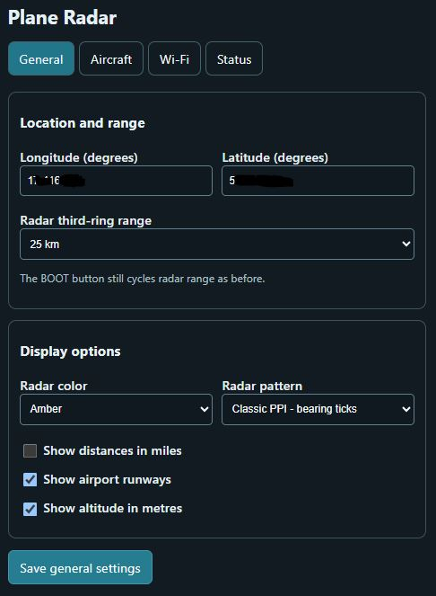
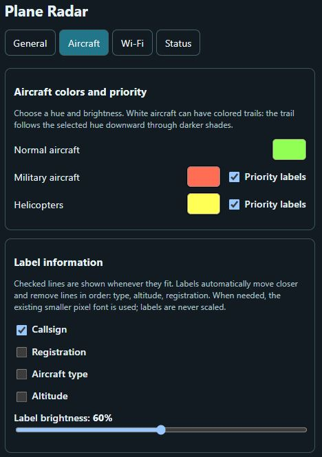
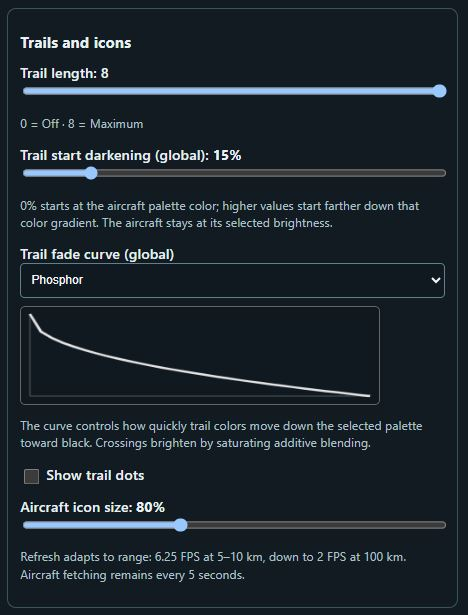
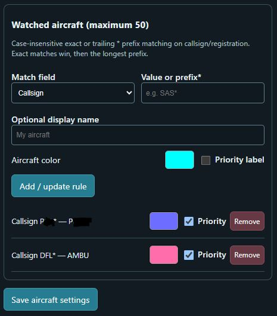
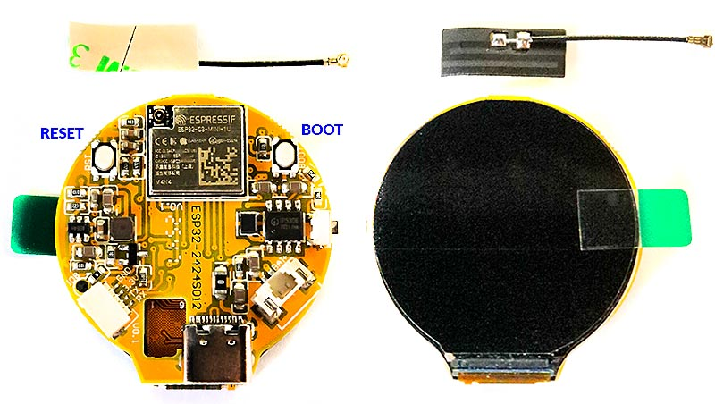

# Plane Radar — enhanced ESP32-C3 fork

A customized fork of [MatixYo/ESP32-Plane-Radar](https://github.com/MatixYo/ESP32-Plane-Radar), built for the **ESP32-2424S012 non-touch** board (ESP32-C3 + integrated 1.28-inch GC9A01, 240 × 240 round LCD).

**Stable source version:** `v2.0.1` (based on overnight-tested rc4.1 firmware; new status counters are pending on-device verification). The existing **v2.0.0** release remains available for rollback.

This is an independently customized firmware branch, **not an official release** of the upstream project. The new semantic version describes this fork; it does **not** imply that every upstream `v1.1.5` change has been merged. See [CHANGELOG.md](CHANGELOG.md) for the changes relative to upstream.

## Pictures

### Background colors

### Radar patterns

### Web control interface

Configure the radar from a browser using the General and Aircraft pages.

<table>
  <tr>
    <td valign="top"></td>
    <td valign="top"></td>
  </tr>
  <tr>
    <td valign="top"></td>
    <td valign="top"></td>
  </tr>
</table>

## Features

- Live aircraft positions from [adsb.fi](https://adsb.fi/) approximately every 5 seconds, via BearSSL HTTPS.
- Six pre-rendered, antialiased radar grid styles: Original, Classic PPI with bearing ticks, Minimal, Polar, Dashed and Super Minimal.
- Selectable green, red, amber, cyan, violet or white radar backgrounds. A brightness map is recolored with a small lookup table; only **one RGB332 framebuffer** is used.
- Anti-aliased aircraft symbols, helicopter rings, screen-edge bearing dots, smooth historical phosphor trails, configurable trail fade curves, and adjustable additive position dots.
- Newly appearing aircraft fade in over **2 seconds**; missing aircraft symbols fade out over **12 seconds** from the first successful feed update that omits them. Symbols add light rather than painting dark pixels over the grid. Labels appear/disappear instantly.
- Aircraft-specific watchlist with custom names in addition to normal labels, priority colors, adaptive label placement, and a global label-brightness control.
- Airport runways, multiple range presets (5, 10, 15, 25, 50, 75, 100 km on the **third of four rings**), kilometres/miles, metric/imperial altitude, diagnostics and on-device web configuration.
- CPU fixed at 160 MHz, display SPI configured at 80 MHz, Wi-Fi TX limited to **8.5 dBm** for stability, Wi-Fi sleep disabled.

## Hardware

**Target:** ESP32-2424S012 *non-touch* module with built-in GC9A01 display. This is not a pin-compatible replacement for the separate-display wiring shown in the original project's README.

Current firmware pin assignment from `include/config.h`:

| Function | ESP32-C3 GPIO |
| --- | --- |
| LCD CS | 10 |
| LCD DC | 2 |
| LCD MOSI | 7 |
| LCD SCLK | 6 |
| LCD reset | -1 (not connected) |
| BOOT button | 9 |

Use a stable USB-C power supply. Wi-Fi transmit power is intentionally reduced; do not raise it blindly on this board.

## What's new in v2.0.1

- **Web reliability:** Independent port-80 radar server; on-demand Wi-Fi manager on port 81. Cooperative `/health` HTTP checks require a real HTTP 200 response and expected body, and rebuild the HTTP server after three consecutive failures (120-second cooldown). Wi-Fi and ADS-B tasks remain running. A local health test does **not** guarantee remote LAN reachability.
- **Overnight ADS-B resilience:** Valid empty feeds are normal; malformed/missing aircraft arrays do not replace the last good feed. Empty-screen rendering wakes when new aircraft arrive. Readable serial diagnostics help distinguish empty airspace from broken HTTP/TLS requests.
- **Trail dots:** Separate anti-aliased, saturating-additive position markers at recorded fixes. Aircraft page sliders control dot spacing (every 1–8 stored samples, default 3) and diameter (2–7 px, default 4.5). Fixed-point rendering; no extra position-history buffer. `Show trail dots` toggles markers.
- **Status counters:** Uptime, health checks passed/failed, HTTP server rebuilds, verified HTTP recoveries, and time since last verified recovery. Counters use RAM only, reset on reboot, and require a built v2.0.1 image.

**Validation:** rc4.1 has been running on the target ESP32-C3 overnight with the radar and browser interface accessible; the v2.0.1 source adds lightweight Status diagnostics and still requires a fresh device build/test. No new precompiled v2.0.1 binary is bundled with the source.

## Install / build

For a fully verified and ready-to-flash **v2.0.1** image, use the `firmware-merged.bin` asset from the v2.0.1 GitHub Release **once published**. Until that binary is available, build the current `main` source following the instructions below. The previous v2.0.0 release remains a fallback.

For advanced users only, `firmware.bin` is the application at `0x10000`, `bootloader.bin` starts at `0x0000`, and `partitions.bin` at `0x8000`. **Normal installation uses only the merged image at `0x0000`.** Never flash the application-only binary at `0x0000` or the merged image at `0x1000`.

Extract the complete source package into a fresh folder. Required assets (`data/ui_font.vlw` and the six RGB332 background images) are included. Run `BUILD.bat` on Windows with PlatformIO or use `pio run -e supermini` (then `pio run -t merge -e supermini`). The output is `.pio/build/supermini/firmware-merged.bin`. `UPLOAD.bat` uses PlatformIO to build/upload to a connected board.

## Configuration

On first boot, use the `PlaneRadar-Setup` Wi-Fi portal. Once connected, open `http://<device-ip>/general` (IP shown in serial diagnostics; `.local` hostname resolution depends on the network). Other pages include Aircraft, Wi-Fi and Status.

- **General:** position (longitude first, latitude second), radar range, background color/pattern, units and runways.
- **Aircraft:** display options, trail settings, fade curve, watchlist names/colors and label brightness.
- **Status:** aircraft count, heap/TLS diagnostics, frame timings, CPU/SPI measurements, uptime and web health/recovery counters (since boot).

**Important:** The repository contains a generic public example location. Configure your own coordinates in the portal. It does not include Wi-Fi credentials or saved settings from a device.

## Performance notes

- One full-screen 57,600-byte RGB332 framebuffer; flash-backed pre-rendered grid maps.
- Fixed-point antialiasing, smooth palette gradients and additive symbol/trail compositing.
- BearSSL is used to reduce peak HTTPS heap pressure on the ESP32-C3. The present client uses `setInsecure()` and **does not validate server certificates**; TLS encryption is present but endpoint authentication is disabled. Do not rely on this for sensitive data or a trusted feed without implementing proper certificate verification.
- The frame rate adapts by range. A few unusually slow frames can result from scheduling/interruptions; Status has timing diagnostics.

## Tests and generated assets

C++ host tests are under `test/`. Background assets are generated by `scripts/generate_flash_grid.py` and `scripts/generate_radar_patterns.py`; precalculated outputs are included for normal PlatformIO builds.

## Upstream credit and license

Original project: **[MatixYo/ESP32-Plane-Radar](https://github.com/MatixYo/ESP32-Plane-Radar)** by MatixYo and contributors. This fork builds on their work. Licensed under the original **MIT License**; the upstream copyright and license notice are preserved in [LICENSE](LICENSE).

### Upstream PR functionality covered

This fork independently implements, adapts, or extends features proposed in upstream pull requests:

- **[#100](https://github.com/MatixYo/ESP32-Plane-Radar/pull/100)** — RGB332 framebuffer to reduce RAM usage.
- **[#90](https://github.com/MatixYo/ESP32-Plane-Radar/pull/90)** — Background ADS-B fetching, HTTP/1.1 streaming, and smoother aircraft movement.
- **[#94](https://github.com/MatixYo/ESP32-Plane-Radar/pull/94), [#21](https://github.com/MatixYo/ESP32-Plane-Radar/pull/21), [#69](https://github.com/MatixYo/ESP32-Plane-Radar/pull/69)** — Memory-efficient JSON streaming and filtering, with improved HTTPS/TLS reliability.
- **[#105](https://github.com/MatixYo/ESP32-Plane-Radar/pull/105)** — Extended radar ranges up to 100 km.
- **[#61](https://github.com/MatixYo/ESP32-Plane-Radar/pull/61)** — Military aircraft identification, with configurable colors and priorities.
- **[#17](https://github.com/MatixYo/ESP32-Plane-Radar/pull/17)** — Airport runway overlays, enhanced with improved rendering and label placement.
- **[#50](https://github.com/MatixYo/ESP32-Plane-Radar/pull/50)** — Latitude-corrected longitude projection.
- **[#23](https://github.com/MatixYo/ESP32-Plane-Radar/pull/23)** — Selectable altitude units (feet/metres).
- **[#30](https://github.com/MatixYo/ESP32-Plane-Radar/pull/30)** — Reduced Wi-Fi transmission power for ESP32-C3 stability.
- **[#76](https://github.com/MatixYo/ESP32-Plane-Radar/pull/76)** — Safe handling of full-length Wi-Fi SSIDs.
- **[#19](https://github.com/MatixYo/ESP32-Plane-Radar/pull/19)** — Web configuration after initial setup, expanded into separate configuration and status pages.

**These are functional equivalents or independent implementations, not a claim that the original PR branches were merged verbatim.** Some implementations differ significantly to suit the ESP32-2424S012 non-touch hardware.

See [CHANGELOG.md](CHANGELOG.md) for a summary of changes from the original project.
